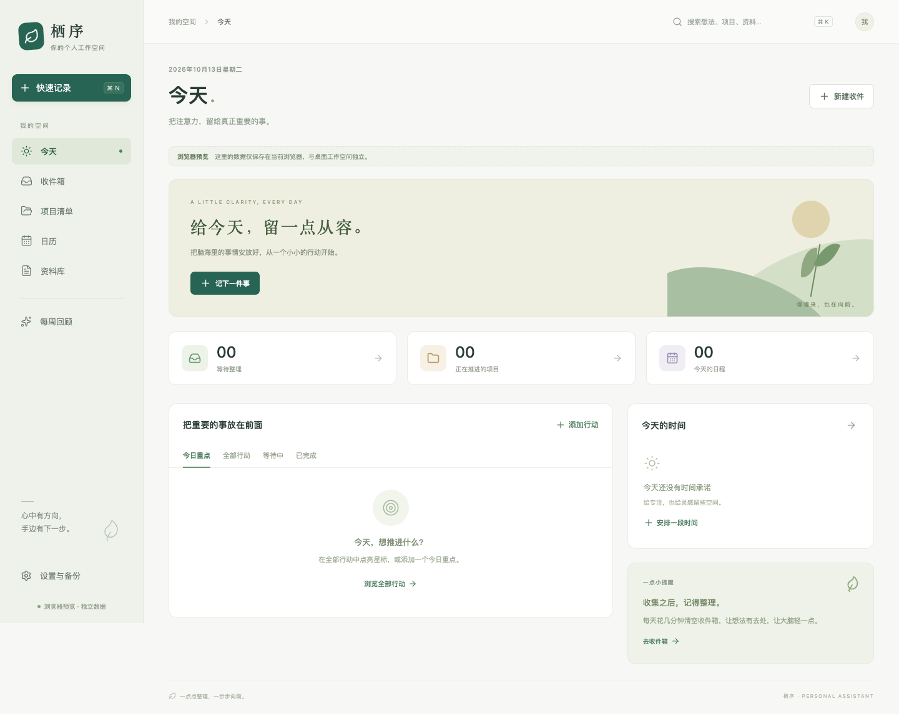

# 栖序 · 个人助手

一个本地优先的桌面工作空间，把 **随手收集 → 整理分流 → 推进下一步 → 回顾归档** 连接起来。

基于 Tauri 2、React、TypeScript、Vite、Rust 与 SQLite。核心工作流离线可用，无需账户。当前版本为 `0.1.0`，优先验证 macOS Apple Silicon。



## 已实现

- **今天**：重点行动、全部行动、等待事项、完成记录、今日日程和未来七天截止事项。
- **收件箱**：文字、链接、文件记录；原子化整理为项目、行动、日程或资料；保留只读原文及来源。
- **项目清单**：完成标准、状态、下一步提示、行动进度；项目详情关联行动、日程和资料。
- **日历**：月视图、全天日期承诺、带起止时间的日程、跨日事件、截止日期标记。
- **资料库**：笔记、链接、代码片段和托管附件；支持项目/行动关联及关键词搜索。
- **回顾**：缺少下一步的项目、逾期行动、等待事项、行动和日程归档恢复。
- **桌面能力**：菜单栏入口、全局快捷记录、文件选择与拖入、单实例运行。
- **备份恢复**：记录、关联和附件一起导出；恢复前校验文件 SHA-256，并保留当前数据安全副本。

AI、系统通知、外部日历同步、手机同步、附件全文/OCR 和自动备份尚未实现。系统不会自动替你安排时间或完成项目。

## 开发与运行

需要 Node.js 24+、npm、Rust stable；macOS 需要 Xcode Command Line Tools。其他平台的系统依赖参见 [Tauri 官方先决条件](https://v2.tauri.app/start/prerequisites/)。

```sh
npm ci
npm run desktop
```

如果刚安装 Rust 而当前终端找不到 `cargo`，先运行 `source "$HOME/.cargo/env"`。

仅预览界面：

```sh
npm run dev
```

浏览器预览使用独立的 localStorage，并显示明确提示。它不会读取桌面 SQLite 数据，不支持桌面附件、全局快捷键和完整备份。

构建 macOS 应用：

```sh
npm run desktop:build
```

应用输出：`src-tauri/target/release/bundle/macos/栖序.app`。当前为本地构建，未配置 Apple Developer 签名、公证或自动更新。

## 验证

```sh
npm run build
npm test
npm run test:e2e
cargo test --manifest-path src-tauri/Cargo.toml
cargo clippy --manifest-path src-tauri/Cargo.toml --all-targets -- -D warnings
npm run format:check
cargo fmt --manifest-path src-tauri/Cargo.toml -- --check
```

浏览器测试在本机使用已安装的 Google Chrome；CI 使用 Playwright Chromium，需先运行 `npx playwright install --with-deps chromium`。端到端测试验证的是浏览器适配层，SQLite、分流事务、附件与恢复由 Rust 测试验证；真实桌面仍需单独进行冒烟检查。

CI 配置保留在 `.github/ci-template.yml`。当前 GitHub 凭据没有 `workflow` 权限，因此没有自动启用 Actions；具备相应权限后，将模板移到 `.github/workflows/ci.yml` 即可启用。上述验证已在本机执行。

## 数据与备份

- macOS 数据目录：`~/Library/Application Support/com.nicholas.assistant/`，也可在设置中查看当前实际位置。
- `assistant.sqlite3`：结构化记录；`attachments/<UUID>/<原文件名>`：复制到应用中的附件。
- 单附件最大 25 MB；备份清单最大 16 MB，附件合计最大 480 MB。备份是未加密 ZIP，扩展名为 `.assistant-backup`。
- 恢复会替换当前记录，但先写入数据目录下的 `before-restore.assistant-backup`。每次成功进入恢复阶段会更新这份安全副本。
- 所有归档均可恢复。附件移除关联后暂不自动清理，以避免误删；后续版本增加空间管理。
- 当前存储适用于个人规模数据，写操作采用一致性事务快照；大型资料库的增量持久化和附件流式备份属于后续优化。
- 时间点存为 RFC 3339，按系统当前时区显示；全天日期/截止日期使用 `YYYY-MM-DD`，不做 UTC 转换。

## 快捷键

| 操作 | macOS | Windows/Linux |
| --- | --- | --- |
| 全局快速记录 | ⌘ ⇧ Space | Ctrl Shift Space |
| 应用内新增收件 | ⌘ N | Ctrl N |
| 全局搜索 | ⌘ K | Ctrl K |

快捷键冲突时仍可使用菜单栏“快速记录”。关闭窗口后应用驻留菜单栏，从菜单栏选择“退出栖序”可完全退出。

## 项目维护

开始任务前阅读 [AGENTS.md](AGENTS.md)、[architecture.md](architecture.md) 和 [current-task.md](current-task.md)。依赖锁文件随代码提交；数据、附件、备份、密钥和构建产物不进入 Git。

## 批量收录生成的 HTML

打开 **资料库 → 从文件夹收录 → 扫描生成页面目录**，即可扫描 `~/.answer-me-with-html/pages`；也可选择其他目录。预览后点击“收录所选”，每个页面自动提取标题并单独建卡。以后使用“扫描新增 / 更新”，已收录内容会跳过；更新项需主动勾选，保留现有标题、备注、标签和项目关联。

普通图片、样式和静态引用脚本随页面保存，打开附件即可在默认浏览器查看。原文件移动不会影响托管副本，完整备份包含页面包。只枚举顶层 HTML/HTM；页面目录以外的资源、缺失资源或不支持的编码会显示原因。JavaScript 模块及动态加载的本地文件与跳转到其他本地页面的导航链接暂不收集，联网资源仍需网络。

版本 0.1.1 可读取旧数据与备份；使用新增收录功能后请勿降级到 0.1.0。单页面包上限 25 MB / 500 个文件，每次扫描最多 1000 份 HTML。当前不做后台目录监听。
